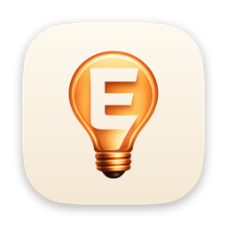
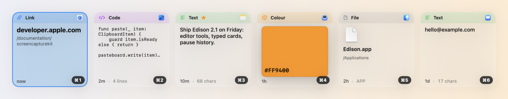
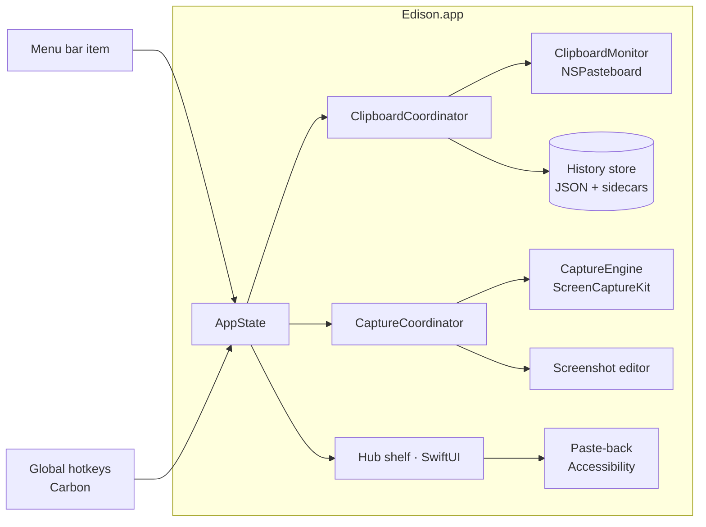

<div align="center">



# Edison

**The fastest way to capture, edit and reuse anything you see or copy on your Mac.**

Edison lives in the menu bar. It keeps everything you copy in a shelf you can search and paste from the keyboard,
and it captures, annotates and shares screenshots without leaving the flow. Everything stays on your Mac.


[](LICENSE)
[](https://github.com/chenkahana/Edison/actions/workflows/ci.yml)
[](CONTRIBUTING.md)

[](https://github.com/chenkahana/Edison/releases/latest/download/Edison.dmg) [](https://chenkahana.com/edison)

[Install](#install) · [Features](#features) · [Shortcuts](#keyboard-shortcuts) · [Architecture](#architecture) · [Getting started](#getting-started) · [Privacy](#privacy) · [Contributing](#contributing)

<picture>
  <source media="(prefers-color-scheme: dark)" srcset="docs/assets/hub-dark.png">
  
</picture>

<sub>Hub cards rendered from Edison's own views with sample data.</sub>

</div>

---

## Install

Download **[Edison.dmg](https://github.com/chenkahana/Edison/releases/latest/download/Edison.dmg)**, open it and drag
Edison to Applications. It needs macOS 14 Sonoma or later, and it's signed with Developer ID and notarized by Apple.
Every version is on the [Releases](https://github.com/chenkahana/Edison/releases) page.

Edison keeps itself up to date. After the second launch it asks whether to check for updates automatically; you can
also choose **Check for Updates…** from the menu-bar icon at any time. Updates are verified against Edison's
signing key before they're installed.

## Features

### Clipboard history

| | |
|---|---|
| **A shelf for everything you copy** | Press **⇧⌘V** and a glass shelf rises from the bottom of the screen with your history as cards: text, links, colours, code, images, screenshots and files. Switch between shelf, list and grid layouts. |
| **Cards that show what an item is** | Links show their site and path, colours show a live swatch, code keeps its indentation, images show their pixel size, and files show their Finder icon and folder. Each card names the app it came from. |
| **Keyboard first** | Arrow keys move, **Return** pastes into the app you were using, **⇧Return** pastes as plain text, and holding **⌘** reveals **⌘1–⌘9** to paste one of the first nine items instantly. Start typing anywhere to search. |
| **Paste exactly what you copied** | Edison keeps the original rich-text, RTF, RTFD and HTML representations byte for byte, so formatted text pastes back formatted. Plain-text paste writes exactly the plain string, never trimmed or re-wrapped. |
| **Search that understands you** | Every word you type must match. Narrow results with `app:Safari` or `type:link` (also `image`, `file`, `colour`, `text`), or use the type filter. |
| **Organize** | Favourite items, group them into collections, drag cards into other apps, preview with **Space** (Quick Look), and undo an accidental delete. |
| **Private by default** | Items marked concealed or transient by password managers are never stored. Pause history from the menu bar whenever you're handling something sensitive; nothing copied in the meantime is captured on resume. |

### Screenshots

| | |
|---|---|
| **Capture** | Area (with live dimensions), window, full screen, or the previous area again, from global shortcuts or the menu bar. Built on ScreenCaptureKit, and correct across multiple displays. |
| **Annotate** | Arrow, line, rectangle, ellipse, pen, highlighter, text, numbered step counter, pixelate and crop. Single-key tool shortcuts, **⇧** to snap to 45° or draw squares and circles, a colour and size bar that remembers your last choice, and unlimited undo. |
| **What you see is what you export** | The canvas and the exported PNG are drawn by the same renderer, so arrowheads, pixelation and text look identical everywhere. Retina captures keep their on-screen size. |
| **Share it your way** | Copy (**⌘C**), copy and close (**⌘↩**), save (**⌘S**), keep it in history, or drag the finished image straight into Finder, Mail or a chat. |
| **Edit anything you've copied** | Open any image from history in the editor with **⌘E**. Saving creates a new item, so the original is never overwritten. |

## Keyboard shortcuts

Global shortcuts can be changed or added in **Settings › Keyboard Shortcuts**.

| Global | |
|---|---|
| **⇧⌘V** | Open or close the Hub |
| **⇧⌘S** | Capture an area |
| *(assignable)* | Capture window, capture full screen, capture previous area, edit last screenshot, pause/resume history, open Settings |

| In the Hub | |
|---|---|
| **← → ↑ ↓** | Move the selection |
| **Return** / **⇧Return** | Paste / paste as plain text |
| **⌘1 … ⌘9** | Paste one of the first nine items (hold **⌘** to see the numbers) |
| *type* / **⌘F** | Search |
| **Space** | Quick Look |
| **⌘E** | Annotate the selected image |
| **⌘O** | Open the selected link, or show the file in Finder |
| **⌘⌫** | Delete (with undo) |
| **Esc** | Close |

| In the editor | |
|---|---|
| **V A L R O P H T N B C** | Select, arrow, line, rectangle, ellipse, pen, highlighter, text, step counter, pixelate, crop |
| **⇧** while drawing | Snap to 45°, or draw a square or circle |
| **← → ↑ ↓** (with **⇧** for 10 pt) | Nudge the selected mark |
| **⌘[** / **⌘]** | Smaller / larger |
| **⌘D** · **⌫** | Duplicate · delete the selected mark |
| **⌘Z** / **⇧⌘Z** | Undo / redo |
| **⌘C** · **⌘↩** · **⌘S** | Copy · copy and close · save |

## Architecture

Edison is a single native macOS app: SwiftUI for the Hub, editor and Settings, and AppKit where macOS needs it
(the menu-bar item, global hotkeys, the floating shelf window, pasteboard access and paste-back). Its one
dependency is [Sparkle](https://sparkle-project.org), which installs updates; Edison itself has no network code.



| Layer | Path | What it holds |
|---|---|---|
| App shell | [`Edison/App`](Edison/App) | Entry point, `AppState`, window routing, menu bar, paste-back into the previous app |
| Core | [`Edison/Core`](Edison/Core) | Models, clipboard monitoring, capture, annotation rendering, persistence, search, shortcuts, settings |
| UI | [`Edison/UI`](Edison/UI) | The Hub shelf, the screenshot editor, Settings and shared components |
| Tests | [`Edison/Tests`](Edison/Tests) | Unit and AppKit integration tests (Swift Testing) |

A guided tour of the source is in [Edison/README.md](Edison/README.md), and the design in
[docs/architecture.md](docs/architecture.md).

## Getting started

### Requirements

- macOS 14 Sonoma or later
- Xcode 16 or later (CI uses Xcode 26). The project uses synchronized folders and the tests use Swift Testing,
  both of which need Xcode 16's toolchain.

### Build and run

```bash
git clone https://github.com/chenkahana/Edison.git
```

```bash
cd Edison && open Edison.xcodeproj
```

Pick the **Edison** scheme and run. To build and test without Xcode:

```bash
swift build && swift test
```

```bash
./scripts/ci-local-macos.sh
```

The Xcode project uses synchronized folders, so new Swift files under `Edison/` are picked up without editing the
project. To run a signed build on your Mac, set your own team in **Signing & Capabilities**.

### Permissions

macOS asks for these the first time they're needed:

| Permission | Why |
|---|---|
| **Accessibility** | To paste the chosen item into the app you were using (Edison sends ⌘V on your behalf) |
| **Screen Recording** | To capture screenshots |

## Repository layout

```
Edison/
├── Edison/
│   ├── App/          App entry point, AppState, windows, menu bar, paste-back
│   ├── Core/         Models, clipboard, capture, rendering, persistence, search, shortcuts
│   ├── UI/           Hub shelf, screenshot editor, Settings, components
│   └── Tests/        Swift Testing suites
├── Assets.xcassets/  App and menu-bar icons
├── docs/             Architecture, privacy, UI style guide, developer guides
├── Config/           Info.plist keys and entitlements for updates
├── scripts/          Local CI, the release script and the pasteboard inspector
├── .github/          CI, issue and pull-request templates
├── Package.swift     Swift package (build and test)
└── Edison.xcodeproj  Xcode project (run and archive)
```

## Privacy

Edison collects nothing. There are no accounts, analytics or crash reporters, and the only network request is the
update check, which sends nothing about you or your clipboard. Your history,
screenshots and settings stay in Edison's sandboxed container on your Mac, and deleting an item deletes its files.
The full policy is in [docs/privacy.md](docs/privacy.md).

## Contributing

Contributions are welcome, from a typo fix to a new annotation tool.

- Read [CONTRIBUTING.md](CONTRIBUTING.md) for setup, conventions and the review checklist, and the
  [source tour](Edison/README.md) to find your way around.
- Looking for a place to start? Try an issue labelled
  [`good first issue`](https://github.com/chenkahana/Edison/labels/good%20first%20issue) or
  [`help wanted`](https://github.com/chenkahana/Edison/labels/help%20wanted).
- Found a bug? Open a [bug report](https://github.com/chenkahana/Edison/issues/new?template=bug_report.yml).
- Security issues go through [SECURITY.md](SECURITY.md), never public issues.

Everyone taking part follows the [Code of Conduct](CODE_OF_CONDUCT.md). Changes are recorded in
[CHANGELOG.md](CHANGELOG.md).

## The family

Boaz, Jimmy and Edison are made by one independent developer, on the same principles: native Swift and SwiftUI,
private by design (no accounts, analytics or tracking), and open source under the Mozilla Public License 2.0.

<table>
  <tr>
    <td align="center" width="33%"><a href="https://github.com/chenkahana/Boaz"></a><br><b><a href="https://github.com/chenkahana/Boaz">Boaz</a></b><br><sub>A calm web browser for iPhone and Mac</sub></td>
    <td align="center" width="33%"><a href="https://github.com/chenkahana/Jimmy"></a><br><b><a href="https://github.com/chenkahana/Jimmy">Jimmy</a></b><br><sub>A queue-centric podcast player for iPhone</sub></td>
    <td align="center" width="33%"><a href="https://github.com/chenkahana/Edison"></a><br><b><a href="https://github.com/chenkahana/Edison">Edison</a></b><br><sub>Clipboard history and screenshots for Mac</sub></td>
  </tr>
</table>

<p align="center"><sub>More at <a href="https://chenkahana.com">chenkahana.com</a></sub></p>

## License

Copyright © 2025–2026 Chen Kahana. Edison is licensed under the [Mozilla Public License 2.0](LICENSE).
See [THIRD_PARTY_NOTICES.md](THIRD_PARTY_NOTICES.md) for the platform components it relies on.
